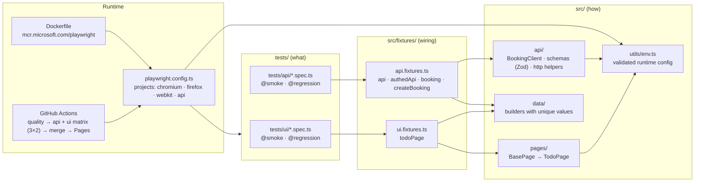
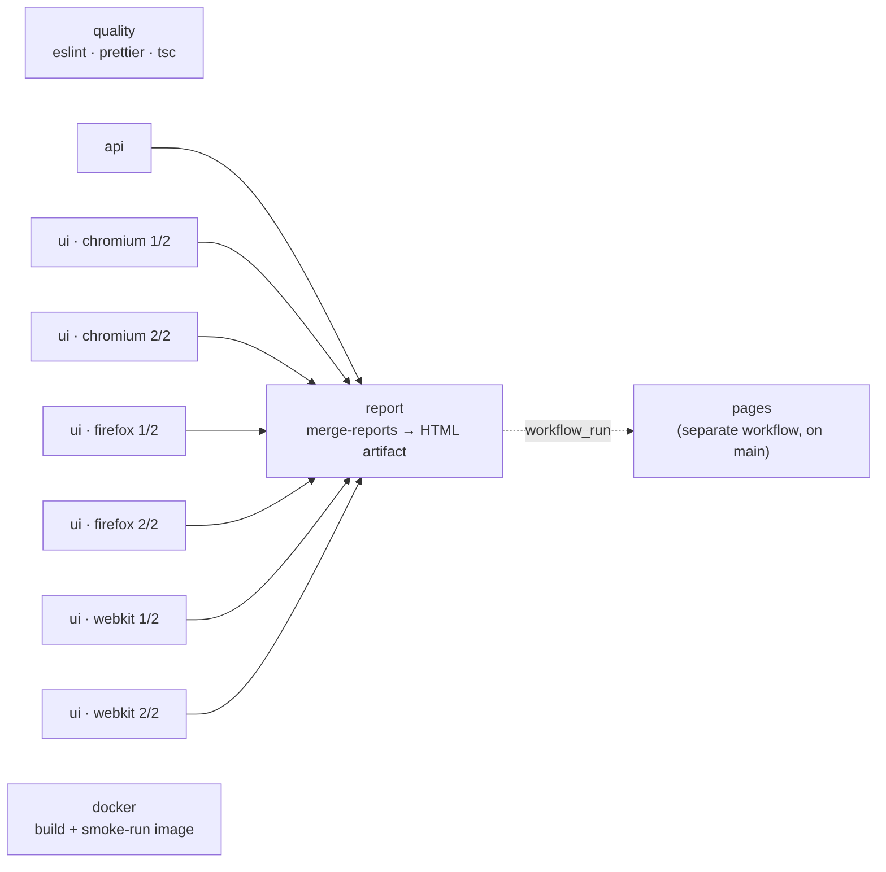

# playwright-enterprise-framework

[](https://github.com/yassineaitt/playwright-enterprise-framework/actions/workflows/ci.yml)
[](https://yassineaitt.github.io/playwright-enterprise-framework/)
[](https://playwright.dev)
[](https://www.typescriptlang.org/)
[](.nvmrc)
[](LICENSE)

A reference Playwright + TypeScript framework laid out the way I build them for product teams:
a **page-object layer that exposes intent**, a **typed API client with Zod contracts**,
**fixtures** for everything cross-cutting, **tags** for selective runs, and a **CI pipeline** that
shards across three browsers, merges the report and publishes it.

Targets are public demo systems so anyone can clone and run it in under two minutes:

| Layer | System under test                                                                       |
| ----- | --------------------------------------------------------------------------------------- |
| UI    | [TodoMVC (React)](https://demo.playwright.dev/todomvc/) hosted by Playwright            |
| API   | [restful-booker](https://restful-booker.herokuapp.com/apidoc/index.html) public sandbox |

## Architecture



**Dependency rule:** arrows only point downward. Tests know fixtures; fixtures know pages/clients;
pages/clients know nothing about tests. Assertions live exclusively in `tests/`.

## Quick start

```bash
nvm use                      # Node 22
npm ci                       # deps + Husky hooks
npm run browsers:install     # Chromium, Firefox, WebKit + OS deps
npm test                     # everything, all projects
```

Useful entry points:

| Command                                       | What it runs                             |
| --------------------------------------------- | ---------------------------------------- |
| `npm run test:smoke`                          | `@smoke` tests across every project      |
| `npm run test:regression`                     | `@regression` tests across every project |
| `npm run test:api`                            | API project only (no browser, ~3 s)      |
| `npm run test:ui`                             | UI tests on Chromium, Firefox and WebKit |
| `npm run test:headed`                         | Chromium, headed, for local debugging    |
| `npm run test:debug`                          | Playwright Inspector                     |
| `npm run report`                              | Open the last local HTML report          |
| `npm run lint` / `typecheck` / `format:check` | The same gate CI runs                    |

Any Playwright flag passes through, e.g. `npx playwright test --project=webkit --grep @smoke --shard=1/2`.

Configuration is read from the environment (optionally a local `.env`, see `.env.example`) and
validated once at startup by `src/utils/env.ts`. No secrets are needed: the API sandbox publishes
its demo credentials.

## Running in Docker

```bash
docker build -t pef .
docker run --rm pef                              # full suite, list reporter
docker run --rm pef --project=api --grep @smoke  # any playwright flags
docker run --rm -v "$PWD/playwright-report:/app/playwright-report" pef --reporter=html
```

The image is built from `mcr.microsoft.com/playwright:v<version>-noble`, pinned to the same
Playwright version as `package.json`, and runs as the non-root `pwuser`.

## Running in CI

`.github/workflows/ci.yml` runs on every push and pull request:



- Each job emits a **blob report**; the `report` job merges them into a single HTML report with
  traces, videos and screenshots attached for failures only.
- `pages.yml` publishes that report to GitHub Pages after every `main` run (green or red).
- `workflow_dispatch` accepts a `grep` input, so a `@smoke`-only run is one click away.
- Retries are `2` in CI and `0` locally, so flakiness shows up on the laptop rather than being
  hidden by the pipeline.

## Tagging strategy

Tags are attached with Playwright's first-class `tag` option, not by polluting titles:

```ts
test.describe('Booking CRUD', { tag: ['@api', '@smoke'] }, () => {
  /* … */
});
test('rejects bad credentials', { tag: '@regression' }, async ({ api }) => {
  /* … */
});
```

| Tag           | Intent                                                | Budget            |
| ------------- | ----------------------------------------------------- | ----------------- |
| `@smoke`      | Must pass on every commit; guards the critical path   | < 1 min / browser |
| `@regression` | Deterministic, broader coverage; runs on every PR too | Minutes           |
| `@ui`, `@api` | Layer markers, used for reporting and local filtering | –                 |

## Design decisions

**Fixtures over inheritance and `beforeEach`.**
Every cross-cutting concern (navigated page, authenticated client, test data with teardown) is a
fixture in `src/fixtures/`. Tests declare what they need in the function signature and get exactly
that, nothing more. Fixtures compose (`booking` depends on `createBooking`, which depends on
`api` and `authedApi`) and tear down in reverse order even when the test fails, which is how
bookings never leak into the shared sandbox.

**Page objects expose intent and locators, not assertions.**
`TodoPage.addTodo()` is a verb; `todoPage.items` is a `Locator`. Tests assert with
`expect(locator)` so Playwright's auto-waiting and retrying apply. Putting `expect` inside a page
object hides the oracle and forces every caller to accept the same assertion.

**Locator priority: test id → ARIA role/label → CSS.**
`data-testid` is a contract with developers; roles are a contract with users; CSS is a fallback.
Nothing uses XPath or nth-child chains.

**Zod schemas as API contracts.**
Every API response is parsed through a schema before a test looks at it. A field renamed on the
server fails with `bookingdates.checkin: Invalid date`, pointing at the drift, rather than with
`expected 'x' received undefined` three lines later. The inferred types double as the client's
request types, so there is one definition of a `Booking`.

**Thin client, no assertions.**
`BookingClient` builds URLs and headers and returns `APIResponse`. The same method serves the
happy path (`expectJson(res, 200, Schema)`) and the negative path (`expect(res.status()).toBe(403)`).

**Validated environment, not scattered `process.env`.**
`src/utils/env.ts` parses the environment once with defaults and types. A typo in `BASE_URL`
fails at startup with a clear message instead of as 40 timeouts.

**Blob reports + `merge-reports`.**
Sharding is only useful if the result is still one report. Each matrix job uploads a blob; one
job merges them. The published HTML report is the single source of truth for a run.

**Retries only in CI, `forbidOnly` in CI, no fixed sleeps anywhere.**
Enforced by config (`retries: CI ? 2 : 0`, `forbidOnly: !!CI`) and by ESLint
(`playwright/no-wait-for-timeout`, `playwright/no-conditional-in-test`,
`playwright/prefer-web-first-assertions`).

**Public demo targets.**
The framework shape is the point. Pointing it at an internal system means swapping `BASE_URL`,
adding page objects and schemas, and nothing else.

## Project layout

```
.
├── .github/workflows/     ci.yml (matrix + merge + docker), pages.yml (report publication)
├── src/
│   ├── api/               booking.client.ts · schemas.ts · http.ts
│   ├── data/              builders for todos and bookings
│   ├── fixtures/          ui.fixtures.ts · api.fixtures.ts
│   ├── pages/             base.page.ts · todo.page.ts
│   └── utils/             env.ts
├── tests/
│   ├── api/               auth · booking.crud · booking.negative
│   └── ui/                todo.smoke · todo.regression
├── playwright.config.ts
├── Dockerfile
└── CONTRIBUTING.md
```

## Contributing

See [CONTRIBUTING.md](CONTRIBUTING.md). Commits follow Conventional Commits and are checked by
commitlint; staged files are linted and formatted by Husky + lint-staged.

## License

[MIT](LICENSE) © Yassine Ait Tamarmoucht
